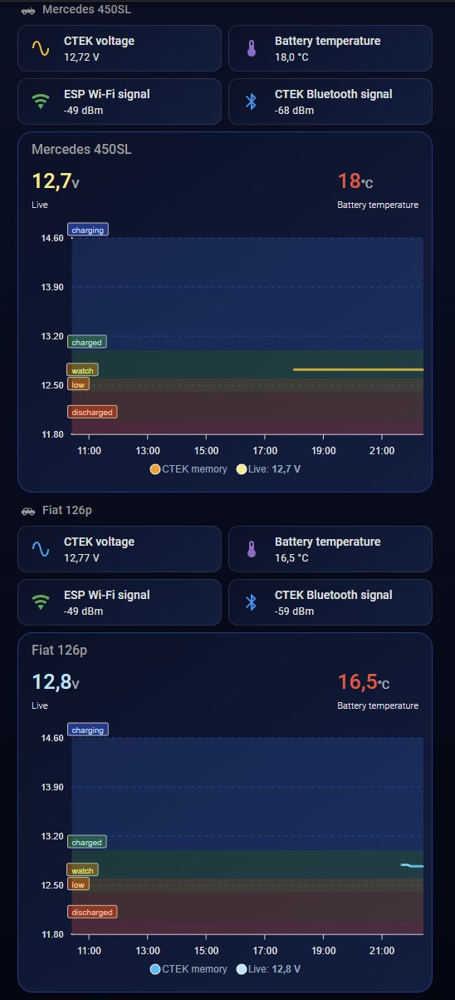

# CTEK Battery Sense → ESPHome → Home Assistant (with history)

Read **CTEK Battery Sense** BLE battery monitors with an ESP32 running ESPHome:
live voltage and temperature **plus the history the CTEK records in its own
memory while the car is away**. Park the car in range of the ESP32 and the
records from the trip are downloaded into Home Assistant automatically.

> Based on [bbartje/CTEK-BLE](https://github.com/bbartje/CTEK-BLE) (archived).
> The unlock method and the basic UUIDs come from that project; the working
> connection sequence, encryption handling and the complete history protocol
> were worked out and **verified on real hardware** here (October 2026).

**Tested with:** 2 × CTEK Battery Sense, one plain ESP32 (rev 3.1) in the garage
serving both, ESPHome 2026.9.1, Home Assistant 2026.8.

## What you get

| | |
|---|---|
| Live values | voltage, temperature, BLE RSSI |
| History | every record from the CTEK memory, sent to HA as events and stored in a sensor attribute + hourly long-term statistics |
| Logging period | read and change it from HA (1–60 min, factory 5 min) |
| Robustness | the next record index survives ESP reboots; the last 240 records are re-sent after every HA restart (HA de-duplicates) |
| Several cars | one ESP32 can serve up to 3 CTEKs – include the package once per device |

No electronics in the car: the CTEK itself is the logger, the ESP32 stays in
the garage on mains power.

## How it works

```
CTEK (in the car)     logs 1 record / N min into its own memory
      │ BLE
      ▼
ESP32 (garage)        unlock → encrypt → read record counter
      │               → request missing records → add timestamps
      │ ESPHome API
      ▼
Home Assistant        event esphome.ctek_<id>_history
                      → template sensor (records)
                      → automation → long-term statistics
```




Records have no timestamp inside the CTEK. The ESP polls the record counter
every 5 s; when it increases, the newest record is "now" and older ones are one
period apart. After a trip the newest record is dated at the moment the car is
back in range (accuracy ≈ one period).

## Quick start

### 1. Find MAC address and code

- **Code:** the 16 characters printed under the barcode on the CTEK
  (e.g. `40149A00W0000000`). If the print is worn, scan the barcode
  (Code 128) – it contains the same string.
- **MAC:** the CTEK advertises as `CTEK` (one of ours as `SBA`). Use nRF Connect
  on a phone, or temporarily add `esp32_ble_tracker:` to any ESPHome device and
  watch the log. Close the CTEK app first – the CTEK accepts only one connection.

### 2. ESPHome

Copy `esphome/ctek-battery-sense.yaml` next to your device config and include it
once per CTEK (see `esphome/example-single.yaml` and `esphome/example-two-cteks.yaml`):

```yaml
esp32:
  board: esp32dev
  framework:
    type: esp-idf          # required

packages:
  car: !include
    file: ctek-battery-sense.yaml
    vars:
      ctek_id: car                    # short, unique, a-z 0-9 _
      ctek_name: "CTEK Car"           # entity name prefix
      ctek_mac: "AA:BB:CC:DD:EE:FF"
      ctek_code: "XXXXXXXXXXXXXXXX"   # 16-char sticker code (unlock is computed on the ESP)
      ctek_skip_existing: "false"     # "true" = don't import records already in the CTEK
```

Or include it straight from GitHub (no files to copy):

```yaml
packages:
  car:
    url: https://github.com/dtech77pl/esphome-ctek-battery-sense
    ref: main
    files:
      - path: esphome/ctek-battery-sense.yaml
        vars:
          ctek_id: car
          ctek_name: "CTEK Car"
          ctek_mac: "AA:BB:CC:DD:EE:FF"
          ctek_code: "XXXXXXXXXXXXXXXX"
          ctek_skip_existing: "false"
```


The package can be added to an ESP32 that already does other things (ours also
drives a 433 MHz battery disconnect switch). Enabling Bluetooth took about
105 KiB of heap on our ESP32 (175 → 69 KiB free); the second CTEK cost another
~13 KiB (56 KiB free).

### 3. Allow the ESP to send events

Home Assistant → Settings → Devices & services → ESPHome → your device →
**Configure** → enable **Allow the device to perform Home Assistant actions**.
Without it the history never reaches HA.

### 4. Home Assistant package

Copy `homeassistant/ctek_car.yaml` to `/config/packages/` (one file per CTEK,
replace `car` with your `ctek_id`) and make sure packages are enabled:

```yaml
homeassistant:
  packages: !include_dir_named packages
```

Restart HA. You get `sensor.ctek_car_history` (records in an attribute) and the
statistic `ctek_car:voltage_history`. Example cards:
`homeassistant/dashboard-cards.yaml`.

### 5. Optional: log every minute

Set **"CTEK Car set log period"** to `1` (box input – press Enter).
⚠️ Changing the period **erases the history stored in the CTEK**. Do it while
the ESP is connected and everything has been downloaded.

## Good to know

- Watch the first connection in the ESPHome log:
  `[1] connected` → `[2] unlock` → `[3] encryption` → `auth success` → `[4] notifications: on` → `[5] ready`.
  A few `status=15` warnings right after connecting are normal (reads that run before encryption is up).
- If reads keep failing after `auth success`, check the sticker code first.
- Memory capacity of the CTEK is not known yet – a trip longer than the memory
  holds will lose its oldest part.
- Disconnecting the battery resets the CTEK memory; the ESP detects the reset
  (`cursor < next`) and starts from record 0.
- The HA sensor keeps the last 5000 records (≈3.5 days at 1 min); long-term data lives in the statistics.
- `tools/ctek_unlock.py` prints the unlock payload for other platforms.
- Full protocol notes: [`docs/PROTOCOL.md`](docs/PROTOCOL.md).

## Credits and license

- Unlock method, base UUIDs and record format: [bbartje/CTEK-BLE](https://github.com/bbartje/CTEK-BLE) (MIT).
- ESPHome gateway, connection sequence, history protocol and HA side: this repository.
- MIT license, see `LICENSE`.
- CTEK and Battery Sense are trademarks of CTEK Sweden AB. This is an independent
  community project for interoperability with devices you own; it is not affiliated
  with, endorsed or supported by CTEK. No CTEK software or artwork is included.
  Use at your own risk.

---

Looking for a Home Assistant custom integration (via Bluetooth proxy) instead of
an ESPHome gateway? See the original project
[bbartje/CTEK-BLE](https://github.com/bbartje/CTEK-BLE) (archived, not validated
on hardware by its author).
